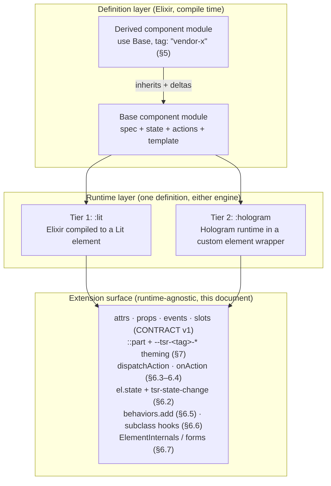

# Tessera extension contract (draft v0)

Normative contract for how third parties extend a tessera element. It sits
above the wire contract (`docs/CONTRACT.md`, v1): the wire contract fixes what
crosses the DOM boundary; this document fixes what an extender may hold on to.
**The runtime is an implementation detail; this extension surface is the
product.** Everything here MUST behave identically whether the element runs on
Tier 1 (Elixir compiled to Lit) or Tier 2 (the Hologram runtime hosted inside
the element).

Status: **draft v0** — items marked `[PENDING TIER-1]` / `[PENDING TIER-2
SPIKE]` are not yet verified against an implementation; nothing here asserts an
unverified runtime capability. Where the code already provides a mechanism
(behaviors, `defineOnce`, `emit`, the bridge) the text cites it.

The key words MUST, MUST NOT, SHOULD, SHOULD NOT and MAY are interpreted per
RFC 2119.

---

## 1. Terminology

| Term | Meaning |
|---|---|
| **Definition** | The Elixir source of truth: a module that `use Noizu.Tessera.Component` (spec; for element components also state/actions/template). Compiles to every artifact. |
| **Spec** | The compiled `Noizu.Tessera.Spec` (`__tessera_spec__/0`): tag, attrs, props, events, slots, cy, and for element components state, actions, regions, runtime. |
| **Runtime** | The engine executing a definition: `:lit` (Tier 1) or `:hologram` (Tier 2). |
| **Wire contract** | `docs/CONTRACT.md` v1: naming, the generated `.contract.generated.mjs`, rendered DOM shape, the bridge. Versioned by `contract.version`. |
| **Extension surface** | Everything an extender may rely on: wire surface, parts + custom properties, action pipeline, state snapshot, behaviors, subclass hooks, form participation. Versioned by `extension_api` (§8). |
| **Base / derived element** | Base: a component module an extender derives from. Derived: the new module produced by Elixir inheritance (§5) — own tag, spec, CEM, artifacts. |
| **Elixir extender** | Derives at compile time with full fidelity (§5). |
| **JS extender** | Extends at runtime through the stable JS API (§6), no recompilation. |
| **Region** | A named, replaceable template span with declared default content (§5.4). |
| **Interceptor** | A function registered with `el.onAction` wrapping one step of the action pipeline (§6.4). |
| **Public action** | An action declared `public: true` — invokable and interceptable from outside (§10). All others are **private**. |

---

## 2. Layering



Every arrow into the extension surface is a MUST: both runtimes implement the
same surface, verified by the shared conformance suite (§9). An extender MUST
NOT need to know which tier executed the element.

---

## 3. The extension surface at a glance

An element's extension surface is exactly this list. Anything not listed is
not contract (§6.8):

1. attrs, props, events and slots — per `docs/CONTRACT.md` v1;
2. `::part` names and the `--tsr-<tag>-*` custom properties the element reads (§7);
3. `el.onAction(name, interceptor)` — intercept the action pipeline (§6.4);
4. `el.dispatchAction(name, params)` — invoke a public action (§6.3);
5. `el.state` — a read-only snapshot, plus the `tsr-state-change` event (§6.2);
6. `behaviors.add(tag, fn)` with cleanup (§6.5);
7. subclassing via `customElements.get(tag)` over a finite hook set (§6.6);
8. `ElementInternals` / form participation where the manifest declares it (§6.7).

---

## 4. Two kinds of extender

**Elixir extenders (compile time, full fidelity).** A vendor derives a new
element from a base component with its own tag, inheriting spec, state,
actions and template, then applies deltas. The derivation is total: the result
is a standalone component with its own contract module, CEM entry and manifest
entry. The same mechanism MUST work for `runtime: :lit` and
`runtime: :hologram` (§5.10).

**JS / any-framework extenders (runtime, stable API).** An integrator working
in JavaScript — with or without a framework, without recompiling anything —
extends a shipped element through §6. This surface is stable across minor
versions and identical across runtimes.

The two are complementary: a vendor who owns the derivation also gets the JS
surface on the derived tag; a JS extender never needs the Elixir side.

---

## 5. Elixir inheritance model

### 5.1 Shape

A component module that defines `__tessera_spec__/0` is extendable. Extension
is `use` of that module with a derived tag:

```elixir
defmodule VendorKit.PersonaCard do
  use PersonaKit.PersonaCard, tag: "vendor-persona-card"
  # spec deltas (§5.5), region overrides (§5.4), action overrides (§5.3)
end
```

- The `use`d module already carries the tessera compiler; the deriving module
  MUST NOT repeat `use Noizu.Tessera.Component` (`CompileError`).
- `tag:` is REQUIRED and MUST differ from the base tag (§5.9).
- `js:` follows the fresh-component rules. [PENDING TIER-1: exact artifact set
  for derived element components, and whether `js:` may be omitted when the
  base's wrapper is shareable.]
- Everything not overridden is inherited: spec entries, state defaults,
  actions, template, regions, runtime, cy rules (§5.7).

### 5.2 Overridable vs final

| Surface | Status | How |
|---|---|---|
| `attr` / `prop` entries | **overridable** (type, `required`, `default` MAY change; removal forbidden) | redeclare (§5.5) |
| new `attr` / `prop` / `slot` / `cy` | **additive** | declare normally |
| `event` | **additive**; inherited MAY be renamed (`renames:`), detail extended; removal and inherited-key changes forbidden | §5.6 |
| `state` entries | **overridable** (type/default); removal forbidden | redeclare |
| `action` | **overridable** (replace body); new actions additive; removal forbidden | §5.3 |
| `init` hooks | **overridable** | `__tessera_init__/2` · `/3`, `defoverridable` + `super` (§5.3) |
| template | **overridable in full** (dead-region/unused-event warning) or per **region** | §5.4 |
| styles | **additive** | base styles always apply; derived MAY append |
| runtime | **inherited by default**; cross-runtime derivation `[PENDING TIER-2 SPIKE]` | §5.10 |
| `tag:` | **final per derivation** — MUST take a new tag; MUST NOT re-register the base tag (§5.9) | |
| reserved names | **final** | `__tessera_*__`, `template/0`, `_`-prefixed keys |
| inherited surface narrowing | **final** | public→private demotion forbidden (§10); removal of attrs/props/events/slots/state/actions forbidden |

Every "forbidden" row raises a pointed `CompileError` naming the base module,
the derived module and the offending entry. Nothing degrades to a warning that
would produce an element violating its own inherited spec.

### 5.3 Overridable hooks: `init` and actions

**Tier 2 shape (`action/3` with `defoverridable`).** The base compiler emits
its actions as overridable clauses, so a derived module overrides with plain
clauses plus `super`:

```elixir
def action(:reset, _params, component), do: put_state(component, selected: false)

def action(:increment, params, component) do
  component = put_state(component, last_vendor_touch: true)
  super(params, component)
end
```

The compiler MUST generate `defoverridable` for every inherited action and
init hook; overriding a name that is neither inherited nor newly declared is a
`CompileError`.

**Tier 1 shape (compiled to Lit) — action redeclaration.** Tier 1 actions are
`action :name, fn state, params -> … end`; a derived module redeclares the
same `action :name` to replace the body. The base body stays reachable:

```elixir
action :increment, fn state, params ->
  state = super_action(:increment, state, params)
  %{state | last_vendor_touch: true}
end
```

`super_action/3` is a generated helper resolving to the nearest inherited
implementation. [PENDING TIER-1: exact helper name/arity; the spike's
`action/2` DSL has no override path yet.]

`init` overrides target `__tessera_init__/2` / `__tessera_init__/3` — never
the generated `init` pair (`docs/AUTHORING.md`). The derived body SHOULD call
`super` (MUST when base actions read state the hook seeds).

**Public/private is part of an action's identity.** A derived module MAY
promote an inherited action to `public: true`; it MUST NOT demote a public
action to private — that silently revokes a declared extension surface
(`CompileError`).

### 5.4 Template regions (`slot_template`)

A region is a named span inside an element component's template with declared
default content. The base declares it inline:

```elixir
template ~TSR"""
<ul class="rows">
  {%region :row}
    <li class="row">{@label}</li>
  {%endregion}
</ul>
"""
```

A derived module replaces the region body:

```elixir
slot_template :row, ~TSR"""
<li class="row vendor-row"><slot name="row-icon"></slot>{@label}</li>
"""
```

Rules:

- `slot_template :name` declares/overrides region `:name`; region names are
  snake atoms following the CONTRACT §1 identifier grammar.
- **Default content** is the region body between `{%region <name>}` and
  `{%endregion}`; it renders when no derived module replaces the region. A
  region MAY ship with an empty body — a pure extension point.
- A `slot_template` for a name the base never declared is a `CompileError`.
- Region bodies are ordinary `~TSR` fragments (the implemented Tier 1 template
  sigil; same dual-lexer rules as `template`). They MAY read attrs, props,
  state and bind events to inherited or new actions.
- Regions may nest; an override MUST NOT change which regions exist inside it.
  [PENDING TIER-1: `` support is new — absent from the spike; lexer/
  codegen confirmation and nesting-depth limits TBD.]
- Whole-template replacement is allowed and discards all region structure;
  the compiler MUST then warn listing inherited events the new template no
  longer emits and regions that no longer exist. The derived CEM no longer
  lists those events (§5.8).
- A region is not a DOM slot: DOM slots stay consumer input at runtime
  (CONTRACT §2 `slots:`); regions are compiled-in, vendor-replaceable
  fragments. A region body MAY contain `<slot>` elements.

### 5.5 Spec deltas and merge rules

The derived spec starts as a deep copy of the base spec; the derived module's
declarations merge in:

- **Additive:** new `attr`/`prop`/`event`/`slot`/`state`/`action` names merge
  in as-is, in declaration order after inherited entries.
- **Override by name:** redeclaring an inherited `attr`/`prop`/`state` entry
  replaces it wholesale (type, `required`, `default`, `json:`). The name MUST
  match an inherited name; a new name is just additive.
- **Type-change guard:** if the base's compiled template or action bodies
  reference an overridden key and the override changes its type, the compiler
  MUST reject (`CompileError`). [PENDING TIER-1: reference-graph pass over
  compiled ASTs; Tier 2: same rule for Hologram-translated bodies —
  `[PENDING TIER-2 SPIKE]` for the equivalent static pass.]
- **`required:`** MAY be relaxed (`true` → `false`, declaring a `default:`),
  MUST NOT be tightened.
- **Removal is forbidden** for attrs, props, events, slots, state and actions
  — the base template and actions may reference any of them. There is no
  removal syntax; violations are `CompileError`s.
- **Collision rules carry over:** duplicates, attr/prop collisions,
  non-round-tripping keys, reserved `_`-prefixed keys — all re-checked over
  the MERGED spec, with lines pointing into the derived file (CONTRACT §1).

### 5.6 Events: add, rename, extend detail

- **Add:** declare normally.
- **Rename:** `event "row-pick", renames: "persona-select"` replaces an
  inherited event name. At compile time: emission points in inherited
  template/actions are rewritten; the binding prop follows (`on_row_pick`,
  default action `:row_pick`, CONTRACT §1); the derived CEM lists only the new
  name; `renames:` MUST target an inherited name, and renaming an
  already-renamed event is a `CompileError`. Renaming changes vendor
  vocabulary, not when or why the event fires. [PENDING TIER-1: rewrite pass;
  the spike's codegen has no rename path.]
- **Detail:** redeclaring an event MAY extend its detail with new keys;
  inherited keys MUST keep their types; dropping or retyping an inherited
  detail key is a `CompileError` (downstream `on_<event>` actions
  pattern-match those keys).
- A derived event MUST NOT use the reserved `tsr-` prefix (§6.2).

### 5.7 Compile-time validation

| Error | Trigger |
|---|---|
| double `use` | deriving module repeats `use Noizu.Tessera.Component` |
| missing/invalid derived tag | absent, fails `^[a-z][a-z0-9]*(-[a-z0-9]+)+$`, or equals the base tag |
| unknown override | `action`/`slot_template`/`__tessera_init__` override of an undeclared name |
| forbidden removal | any attempt to drop an inherited entry |
| type-change on referenced key | §5.5 type-change guard |
| detail narrowing | event redeclare drops or retypes an inherited detail key |
| public demotion | public → private action override |
| region mismatch | override for an undeclared region; body adds/removes nested regions |
| broken rename chain | `renames:` target missing or already renamed |
| merged-spec violations | duplicates, collisions, round-trip failures, reserved keys |
| extension-api pin mismatch | derived pin unsatisfied by the base (§8) |

### 5.8 Derived artifacts

A derived component generates everything a fresh one does, from the merged
spec — nothing else: `__tessera_spec__/0` (merged, `derived_from:` naming the
base) and `__tessera_manifest__/0`; `<snake_derived_tag>.contract.generated.mjs`
(byte-deterministic, gitignored); the CEM and `tessera-manifest.json` entries
for the derived tag; in Hologram hosts the render/bridge glue for the derived
tag; for Tier 1 element components the derived element module. The base's
artifacts are untouched — the derived CEM is the only description of the
derived surface. `extension_api` flows from the base unless the derived module
declares its own (§8.3).

### 5.9 Tag naming rules

- Derived tags follow the fresh-component rule
  `^[a-z][a-z0-9]*(-[a-z0-9]+)+$` (`Noizu.Tessera.Naming.tag_regex/0`).
- A derived tag MUST differ from the base tag. **Replacing the base tag is not
  part of inheritance.** Tag identity is how consumers, manifests and the
  bridge pin an element; a derivation that hijacked `persona-card` would
  silently rewrite the surface every consumer of the base resolved. The
  sanctioned tag-replacement path is the host-app `element:` swap
  (`docs/EXTENDING.md` §3, Phase 2) — a deliberate host decision keeping the
  contract module identical, and the swapped element MUST satisfy this
  contract (§9 applies to it too).
- Deriving from a derived element is allowed (linear chaining; each hop takes
  a new tag; a cycle is a `CompileError`).
- The `tsr-` prefix is reserved for tessera; vendor tags SHOULD carry their
  own namespace (`vendor-…`). Cross-package uniqueness is a runtime concern
  handled by `defineOnce` (first registration wins, warn once per document).

### 5.10 Runtime selection

A derived element inherits the base's `runtime:`. Same-runtime derivation is
fully supported on both tiers: the merged spec compiles under the inherited
runtime. Cross-runtime derivation (`:lit` base derived as `:hologram` or the
reverse) — `[PENDING TIER-2 SPIKE]`; this contract does not assert it. If
confirmed, every §5.7 check MUST apply identically; if not, it is a
`CompileError`. `runtime:` never appears in the JS extension surface — JS
extenders (§6) are runtime-blind by construction.

---

## 6. JS extension API

Signatures are TypeScript-style. All members below are contract, versioned by
`extension_api` (§8). Anything marked *internal* is out of contract forever.

### 6.1 Static and instance surface

```ts
interface TesseraStateSnapshot {
  readonly [key: string]: unknown;   // snake_case keys, CONTRACT §1 grammar
}

type ActionNext = (paramsOverride?: Record<string, unknown>) => unknown | Promise<unknown>;

type ActionInterceptor = (
  params: Record<string, unknown>,   // snake_case keys, data-only
  next: ActionNext,
) => unknown | Promise<unknown>;

interface DispatchResult {
  ok: boolean;
  reason?: "not-public" | "unknown-action" | "vetoed" | "error";
  value?: unknown;
}

interface TesseraElementStatic {
  readonly tesseraTag: string;             // e.g. "persona-card"
  readonly tesseraContractVersion: number; // wire contract (1 today)
  readonly tesseraExtensionApi: string;    // semver, §8
  readonly tesseraPublicActions: readonly string[];
}

interface TesseraElementInstance {
  get state(): TesseraStateSnapshot;       // fresh frozen snapshot (§6.2)
  onAction(name: string, interceptor: ActionInterceptor): () => void;
  dispatchAction(name: string, params?: Record<string, unknown>):
    DispatchResult | Promise<DispatchResult>;
}
```

`TesseraElement(Base, contract)` (the existing mixin, CONTRACT §4) is the
carrier; both runtimes attach these members to the mixed class, so a plain
`HTMLElement`-based and a Lit-based element expose the identical instance
surface.

### 6.2 State snapshot and `tsr-state-change`

- `el.state` returns a **fresh** snapshot per access. Top-level properties are
  frozen; nested values are shared references and MUST be treated as
  read-only (the runtime does not deep-freeze).
- **Keys are snake_case**, byte-identical to the declared Elixir state keys.
  State keys never cross the DOM naming boundary, so CONTRACT §1's camel
  transforms do not apply — the declared snake name *is* the JS name, matching
  the Tier 1 spike convention (state keys snake_case while attrs/props
  camelCase). State keys MUST satisfy the CONTRACT §1 round-trip grammar.
- `tsr-state-change` — composed, bubbling `CustomEvent` (same dispatch shape
  as `emit`), fired after a state transition commits:

  ```ts
  detail: { keys: string[]; state: TesseraStateSnapshot }
  ```

  `keys` are snake_case, covering exactly the keys the transition changed; one
  event per transition (an action changing three keys fires one event, not
  three). Timing: after the transition is applied and rendering scheduled —
  Lit: subscribers awaiting `el.updateComplete` see the new DOM; Tier 2:
  `[PENDING TIER-2 SPIKE]` for the commit point. The event fires on the
  element; it is not bridge traffic and MUST NOT appear in `data-tsr-on`.
- Transitions rejected by the pipeline (§6.4 veto/error) or dropped after
  disconnect MUST NOT fire the event.

### 6.3 `dispatchAction`

```js
el.dispatchAction("reset", { keepSelection: false })
```

- **Public actions only.** An action is invokable from outside only when its
  spec declares `public: true` (§10). Private or unknown names MUST NOT run:
  the call returns `{ ok: false, reason: "not-public" | "unknown-action" }`
  synchronously, logs a dev-mode warn, changes no state, emits nothing, and
  does not throw.
- Params are data-only and JSON-safe. On entry the runtime deep-normalizes
  keys **camel → snake** (the CONTRACT §1 transform, same code path as the
  bridge's `snakeKeysDeep`), strips `_`-prefixed reserved keys with a warn
  (the tsr-props reserved-key guard, applied to params), and rejects
  function-valued params (`reason: "error"`).
- Return: the pipeline result as `DispatchResult` — or `Promise<DispatchResult>`
  when any stage is async. Callers MUST treat both shapes as possible.
  [PENDING TIER-1: `value` normalization from the spike's internal next-state
  return, which currently exposes nothing.]
- `dispatchAction` is the ONLY sanctioned invocation path for page scripts.
  Calling `__action_*` / `__tesseraRunAction` or mutating state properties
  directly is not contract (§6.8).

### 6.4 Interceptor pipeline

```js
const off = el.onAction("increment", (params, next) => {
  analytics.tick("increment", params);
  return next({ ...params, step: 2 });   // params override, optional
});
// later: off();
```

- **Ordering.** Registration order is onion order: the FIRST-registered
  interceptor is the OUTERMOST — it runs first and its `next` invokes the
  second-registered; the innermost `next` invokes the element's own action.
  "Earlier installed wraps later installed."
- **Veto / cancellation.** Returning without calling `next` cancels the
  action: no downstream stage runs, no state changes, no events emit, no
  `tsr-state-change`; the interceptor's return value becomes the pipeline
  result. This is the only sanctioned cancellation — no external abort.
- **Async.** If any stage returns a Promise, the pipeline result is a Promise
  chaining every stage; the final state application is awaited on it. A stage
  resolving after the element disconnected MUST NOT apply state or emit
  (stale-resolution drop).
- **Params flow.** `params` are the snake-normalized entry params (§6.3) — or
  the event detail normalized the same way for internal template-bound
  invocations. `next(paramsOverride?)` replaces params for all downstream
  stages (same normalization applies to the override).
- **Errors.** A stage that throws before `next` surfaces to the
  `dispatchAction` caller (`{ ok: false, reason: "error" }`; internal
  invocations catch it), emits `tsr-action-error`, and skips all downstream
  stages. A stage SHOULD NOT throw after `next` — the action may already have
  committed; the error still surfaces but cannot roll back.
- **Internal invocations** (template-bound `$click={:action}`) pass through
  the same pipeline and are interceptable by the same rules.
- **Private actions.** Registering an interceptor for a non-public action
  works today but is *not contract*: the runtime warns ("not part of the
  declared extension API") and the surface MAY break on any minor bump
  (§8.2). Only `tesseraPublicActions` names are stable interception targets.
- `onAction` returns an unsubscribe function. Registration is
  per-element-instance and survives disconnect/reconnect; a behavior wanting
  per-connection interceptors registers them in the behavior and unsubscribes
  in its cleanup.

`tsr-action-error` — composed, bubbling:
`detail: { action: string; message: string; error?: unknown }`.

### 6.5 Behaviors

Existing mechanism (`priv/js/src/behaviors.mjs`), contract-fixed:

```ts
interface Behaviors {
  add(tag: string,
      fn: (el: TesseraElementInstance) => void | (() => void),
      opts?: { api?: string }): () => void;   // returns unsubscribe
  remove(tag: string, fn: Function): void;
  get(tag: string): Function[];
}
```

- `fn` runs on EVERY `connectedCallback`; its cleanup runs on the matching
  `disconnectedCallback`; throwing behaviors are caught and warned, never
  breaking the element (all three implemented).
- Registry on the bridge singleton — cross-bundle visibility holds.
- `add` returns an unsubscribe function (additive to today's `void`).
- `opts.api` pins the extender's supported range (§8.4): major mismatch ⇒
  warn + SKIP registration (never break the element); minor mismatch ⇒ warn
  only.

### 6.6 Subclass hooks

Subclassing via `customElements.get(tag)` and `defineOnce` (first definition
wins) is contract under this finite hook list:

| Hook | Obligation | Notes |
|---|---|---|
| `connectedCallback()` | MUST call super | behaviors + bridge registration live here |
| `disconnectedCallback()` | MUST call super | behavior cleanups live here |
| `attributeChangedCallback(n, o, v)` | MUST call super | contract coercion + tsr-props live here |
| `firstUpdated()` / `updated()` | SHOULD call super | Lit-backed runtimes only |
| `shouldUpdate()` | MAY override; MUST NOT unconditionally return `false` | would freeze contract behavior |
| `render()` | Tier 1: overridable, MUST return a lit template. Tier 2: **not portable** — replacing it bypasses the hosted Hologram mount. `[PENDING TIER-2 SPIKE]` | |

Everything else is reserved: `__tessera*` / `__action_*` members,
`__tesseraState/SetState/RunAction`, `static properties`/`static styles`
*mutations after registration* (a subclass MAY add reactive properties
additively via the underlying runtime's mechanism; it MUST NOT retype or
remove inherited ones), `observedAttributes` (derived from the contract), and
`_`-prefixed members (tessera-internal per CONTRACT §4).

### 6.7 Form participation

When the manifest declares `formAssociated: true`, the element MUST
participate in forms through `ElementInternals` (`attachInternals`,
`setFormValue`, `setValidity`, `formDisabledCallback`, `formResetCallback`).
Extenders may rely on form participation only when declared, and MUST NOT
attach internals to an element that did not. [PENDING TIER-1] and
[PENDING TIER-2 SPIKE] for implementations.

### 6.8 Explicitly NOT part of the contract

- Any `__tessera`- or `__action_`-prefixed member; any `_`-prefixed property.
- The internal representation of state (Lit reactive properties, Hologram
  state cells) — read it through `el.state`.
- Bridge singleton internals beyond the documented `behaviors` namespace;
  `globalThis.Hologram` — host runtime, never an extension path.
- Shadow-DOM internals: open shadow roots are open for *debugging*; querying
  into them is not a stable surface — re-emit (`docs/EXTENDING.md` §4) and
  parts (§7) are the sanctioned paths.
- `data-tsr-on` values authored at runtime by page scripts (render-time
  adapter output).
- Replacement of the element's tag from an extension module (§5.9).

---

## 7. Theming

- **Parts.** Styleable internals are exposed as `::part(name)` targets. Part
  names are lower-kebab, element-scoped, and MUST NOT carry the tag prefix —
  scoping comes from the selector (`persona-card::part(row)`). Every exposed
  part is declared in the CEM (`parts`) and MUST exist in the rendered DOM of
  both runtimes (X-14). The host element SHOULD expose a `root` part.
  Composites re-exposing inner parts MUST declare `exportparts`, with
  re-exposed names prefixed by the composite (`outer-inner`).
- **Custom properties.** Every CSS custom property an element reads is
  `--tsr-<tag>-<prop>`: tag verbatim (hyphens kept), prop lower-kebab —
  `--tsr-persona-card-accent`. Components MUST declare each property they
  read in the CEM (`cssCustomProperties`) with its fallback default, and MUST
  provide the `var()` fallback so an unthemed element renders correctly.
  Un-prefixed globals are never read; a design-token cascade reaches the
  element only through its declared `--tsr-<tag>-*` properties. `--tsr-*`
  without a tag segment is reserved for tessera itself.
- Theming is contract: a minor bump may ADD parts and properties; renaming or
  removing one is a major bump (§8.2).

---

## 8. Versioning and compatibility

### 8.1 Two version axes

| Axis | Versions | Where | Today |
|---|---|---|---|
| **Wire contract** (`contract.version`) | attrs/props/events/slots naming, contract-module shape, DOM shape, bridge | CONTRACT §2 `version`, `tesseraContractVersion` | 1 |
| **Extension API** (`extension_api`) | §3's surface: action pipeline, state snapshot + events, behaviors signature, subclass hooks, theming, forms, public actions | manifest + CEM + `tesseraExtensionApi` | none yet; first stable value `1.0.0` |

The axes move independently. This document itself is versioned separately
(draft v0 → 1.0.0 at first stable release).

### 8.2 Semver and deprecation policy

- **MAJOR** — removing/renaming a public action, event, part or custom
  property; changing a state snapshot key; changing interceptor ordering or
  result semantics; narrowing the subclass hook set.
- **MINOR** — additive: new public actions, events, parts, properties, hooks;
  new optional arguments; new detail keys on existing events.
- **PATCH** — fixes and clarifications with no surface change.
- **Deprecation.** A deprecated surface keeps working until the next major,
  is declared in the CEM (`deprecated: true`), and MUST emit a dev-mode
  warn-once on first use (per tag, same discipline as `defineOnce`). Silent
  removal at a minor is a contract violation.

### 8.3 Declaring the version

An element declares its extension API version in its spec
(`__tessera_spec__`), which flows into `tessera-manifest.json`
(`"extension_api": "1.0.0"` per component), the CEM (per-module custom field
`tessera: { "extensionApi": "1.0.0", "publicActions": ["reset", …] }` — CEM
consumers ignore unknown keys by convention), and the runtime static
`tesseraExtensionApi`. The base declares; a derived element inherits unless it
declares its own (then §5.7's pin check applies). [PENDING TIER-1: the spec
struct gains the field; nothing reads it today.]

### 8.4 Pinning and mismatch

- **Elixir extenders** pin at derivation: `use Base, tag: "…",
  extension_api: "~> 1.0"`. Unsatisfied MAJOR ⇒ `CompileError`; unsatisfied
  minor range ⇒ compile warning listing what the base does not declare.
- **JS extenders** pin at the extension point: `behaviors.add(tag, fn, {
  api: "^1.0.0" })` (`onAction` gains the same option in a minor). Major
  mismatch ⇒ warn + skip registration; minor ⇒ warn only; no range ⇒ no
  check.
- **Runtime mismatch warnings** are dev-mode, warn-once per tag+extender
  (warn-once set on the bridge singleton), stating both versions.
- `mix tessera.manifest` reports unsatisfied pins as warnings; hard failure is
  the host's policy choice.

---

## 9. Runtime equivalence

Tier 1 and Tier 2 MUST implement this contract identically; their difference
is confined to the runtime layer. Two rules make that checkable:

1. **One spec, two engines.** Both tiers compile from the same merged spec —
   the spec is the interface between definition and runtime. Conformance
   renders the same spec on both engines and asserts the same surface.
2. **Shared conformance suite.** The lit-parity suite
   (`docs/notes/lit-parity.md` §4) already pins the wire behaviors
   (C-01…C-15, T-01…T-09, D-01…D-07, S-01…S-06, SD-01…SD-03, E-01…E-03) and
   its runner rule stands (§4.2: each tier provides its own runner adapter;
   the suite defines expected behavior, not runners). Extension-surface
   conformance extends it:

| Test ID | Asserts |
|---|---|
| X-01 | registration identity: `customElements.get(tag)` returns the mixed class; `defineOnce` dedupes across copies |
| X-02 | attrs/props/events/slots observed at runtime match the generated contract exactly |
| X-03 | contract events dispatch composed+bubbling `CustomEvent`s, camelCase detail keys (CONTRACT §1 emit boundary) |
| X-04 | bridge maps `data-tsr-on` → action with deep snake_case params (CONTRACT §4) |
| X-05 | `el.state`: snake_case keys, fresh frozen snapshot, matches declared state keys |
| X-06 | `tsr-state-change`: one event per transition; `keys` covers exactly the changed keys; `state` is post-transition |
| X-07 | `dispatchAction` gate: private/unknown ⇒ `{ok:false}` + warn, no state change, no event; public ⇒ runs |
| X-08 | interceptor ordering: first-registered outermost; param overrides flow downstream |
| X-09 | veto: no `next` ⇒ no state change, no events, result returned to caller |
| X-10 | async pipeline: Promise chaining; post-disconnect resolution applies no state, emits nothing |
| X-11 | error path: throwing stage ⇒ `tsr-action-error` + `{ok:false, reason:"error"}`; downstream skipped |
| X-12 | behaviors: add → connect → cleanup on disconnect; throw isolation; `remove`; unsubscribe return |
| X-13 | subclass hooks: allowed set works with super-chaining; reserved members enforced |
| X-14 | theming: every declared part exists in rendered DOM; declared custom properties resolve with fallbacks |
| X-15 | `tesseraExtensionApi` / manifest `extension_api` / CEM field agree; pin warnings fire on major mismatch |
| X-16 | Elixir derivation end-to-end: derived tag registers, merged spec drives DOM, base artifacts untouched |
| X-17 | region replacement end-to-end: default renders unoverridden; override renders on the derived tag; unknown-region override fails compilation |
| X-18 | tsr-props reserved-key and method-key skip warnings (existing behavior, pinned) |

Tier 1 runs the suite against compiled elements (WTR, as the spike does);
Tier 2 runs it in the Hologram-in-element harness with its init wait. A
surface test that cannot pass identically on both tiers is a bug in this
document, not a runtime quirk.

---

## 10. Security considerations

- **Page scripts are outside the element's trust boundary.** Anything on the
  page can already listen to the element's composed events and read its open
  shadow DOM; the gate that matters is *invocation*: `dispatchAction` is
  **default-deny** — only actions declared `public: true` run from outside
  (§6.3). Declaring `public: true` is the author's promise that the action is
  safe to invoke with untrusted params at any time. The cost is one option on
  the actions a vendor wants to expose, and it defaults closed.
- **Params are data, never code.** Function values are rejected;
  `_`-prefixed keys are stripped; keys are case-normalized — all before any
  interceptor or action sees them (§6.3). An action MUST treat its params as
  untrusted input even when invoked internally.
- **Interceptors run with the page's privileges**, not elevated ones.
  Vetting third-party interceptor code is the integrator's job, as for any
  listener they add. The pipeline's guarantees (veto semantics, error
  containment, no state application after disconnect) bound what a hostile
  interceptor can *do*, not what it can *see*.
- **`dispatchAction` flooding** is a host concern; the contract sets no rate
  limit, but public actions SHOULD be idempotent-or-guarded by design.
- **No code paths through strings.** Regions and overrides compile from
  Elixir literals through the restricted translator; there is no
  eval-of-strings on any contract path.
- **Form participation** (§6.7) follows the platform's `ElementInternals`
  model; a `formAssociated` element MUST validate untrusted user input like
  any form control, and its declared form value shape belongs in the CEM.

---

## 11. Migration from `docs/EXTENDING.md`

`docs/EXTENDING.md` remains the JS-side how-to; this document is the contract
it now cites. Mapping:

- §1 behaviors → §6.5 (same mechanism; `add` gains an unsubscribe return and
  the `api:` pin).
- §2 subclass + `defineOnce` → §6.6 (the informal "override the template or
  lifecycle" becomes the finite hook list; `render` is tier-scoped).
- §3 `use ..., element:` (Phase 2, **unimplemented** — the option is silently
  ignored today, tracked as F-04) → the sanctioned host-level tag swap
  (§5.9). This draft adds the requirement the swap must satisfy: the
  replacement element MUST pass the same conformance suite (§9) against the
  SAME contract module. No Elixir-side change is specified here; the option's
  semantics remain as described in EXTENDING.md §3 until Phase 2 lands.
- §4 re-emit → unchanged; it stays the sanctioned composition pattern and the
  reason shadow-DOM crawling is not contract (§6.8).

Nothing in this draft removes an existing surface; the first breaking change
rides `extension_api` 2.0.0, not this document.

---

## 12. Open questions

**[PENDING TIER-1]** (spike proved the element DSL; these surfaces are new):

- T1-1 — region syntax (`` / `{%endregion}`) in the dual lexer and
  codegen; nesting limits; interaction with slot rendering.
- T1-2 — action override convention: `super_action/3` name/arity; generated
  `defoverridable` equivalents for fn-based actions.
- T1-3 — event-rename rewrite pass over compiled emission points; binding-prop
  regeneration.
- T1-4 — type-change reference-graph pass over compiled template/action ASTs.
- T1-5 — `dispatchAction` sync/async return contract; `DispatchResult.value`
  normalization.
- T1-6 — `el.state` getter + `tsr-state-change` commit point relative to Lit's
  update cycle.
- T1-7 — `extension_api` in spec/codegen/CEM; pin checking.
- T1-8 — form participation (`formAssociated`) implementation.
- T1-9 — derived-element artifact set; whether `js:` may be omitted when the
  base wrapper is shareable.

**[PENDING TIER-2 SPIKE]** (the branch has the `Emit` host-bridge seam and two
stock Hologram components; no wrapper runtime or notes yet):

- T2-1 — the custom element wrapper: how the Hologram runtime mounts inside
  it; Declarative Shadow DOM emission/hydration (parity roadmap Phase 3).
- T2-2 — state projection: how Hologram component state surfaces as
  `el.state` and fires `tsr-state-change`; the commit point after a re-render.
- T2-3 — action pipeline: where `dispatchAction`/`onAction` intercept relative
  to the `Emit` seam's synthetic `<cid>$h` bridge and Hologram's dispatcher.
- T2-4 — event emission parity: `Emit.emit/3` snake→kebab + camelCase detail
  vs the CONTRACT §1 emit boundary; whether the seam becomes contract or is
  replaced by the wrapper.
- T2-5 — template/region semantics under Hologram's own template engine.
- T2-6 — cross-runtime derivation (§5.10): supported or `CompileError`.
- T2-7 — the static type-change guard for Hologram-translated bodies.
- T2-8 — whether any guarded `render()` override is exposed on Tier 2.

**Unresolved design questions for review:**

- Q1 — `behaviors.add`'s `api:` pin: skip-on-major-mismatch (current §8.4
  stance) or register-and-warn? Skipping protects the element; warning favors
  extender continuity.
- Q2 — interceptor attachment to private actions is warned-but-allowed
  (§6.4); should it be a hard error instead?
- Q3 — Tier 1 actions return next state internally and expose nothing today;
  confirm `DispatchResult.value` semantics before stabilizing
  `extension_api` 1.0.0.
