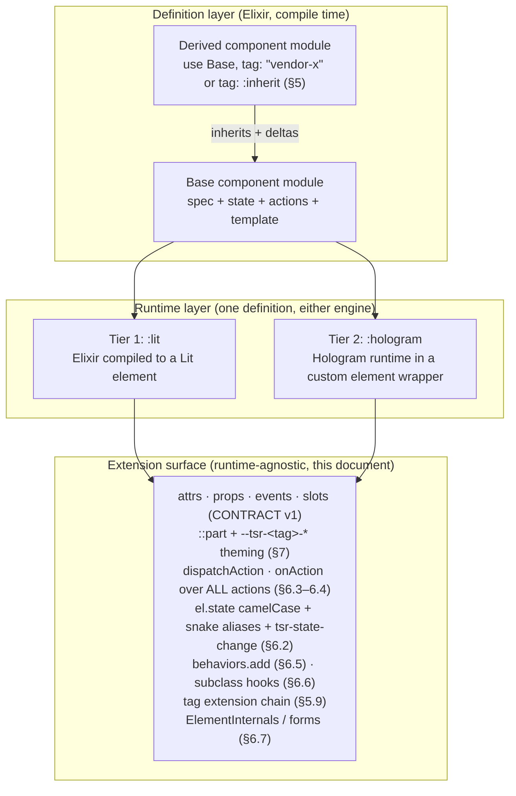

# Tessera extension contract (draft v0.1)

Normative contract for how third parties extend a tessera element. It sits
above the wire contract (`docs/CONTRACT.md`, v1): the wire contract fixes what
crosses the DOM boundary; this document fixes what an extender may hold on to.
**The runtime is an implementation detail; this extension surface is the
product.** Everything here MUST behave identically whether the element runs on
Tier 1 (Elixir compiled to Lit) or Tier 2 (the Hologram runtime hosted inside
the element).

Status: **draft v0.1 — user-confirmed 2026-11-11** — items marked `[PENDING
TIER-1]` / `[PENDING TIER-2 SPIKE]` are not yet verified against an
implementation; nothing here asserts an unverified runtime capability. Where
the code already provides a mechanism (behaviors, `defineOnce`, `emit`, the
bridge) the text cites it. v0.1 applies the decisions in the log below to
draft v0; nothing has shipped against v0, so the changes are in-place, not
deprecations. The decision expansions (§5.3's canonical macro, §5.9's layered
extension) are user-confirmed; the pending markers are implementation debts,
not open decisions.

## Decisions log

| # | Date | Source | Decision |
|---|---|---|---|
| **D1** | 2026-11-11 | user, 2026-11-11 | **Tag takeover** — "replace but extend not replace." A derived element MAY register under the base's original tag (`use Base, tag: :inherit`) and doing so is always an *extension*: inherited behaviour keeps working — overrides layer on top (Elixir: the `base_action/3` dispatch chain, §5.3; JS: real ES `super`) — the base-tag conformance suite MUST still pass on the extended element, and several extenders of one tag COMPOSE in a deterministic chain instead of last-wins. Mint-a-new-tag derivation stays available and stays the default whenever `tag:` is given a literal. The detailed composition semantics (chain order, conflicts, base-suite gate) were the coordinator's expansion of the terse answer and were **confirmed by the user the same day** — §5.9 is final as written (Q4 resolved). |
| **D4** | 2026-11-11 | user, 2026-11-11 | **Canonical extension macro.** `use Vendor.Element` — the base module's generated `__using__` — is the REQUIRED extension mechanism on Tier 2, expanding to the injected `base_action/3` dispatcher, `defoverridable` declarations, `tag:`/`:inherit`/`priority:` handling and the chain-conflict warnings (§5.3). Hand-rolled scaffolding stays possible but carries no contract standing unless the result passes X-19. |
| **D2** | 2026-11-11 | user, 2026-11-11 | **All actions open.** The `public: true` gate and the `not-public` DispatchResult reason are removed; any action can be dispatched by name and intercepted. Statics: `tesseraActions` (every action name) replaces `tesseraPublicActions`. §10 states the trade-off honestly; an advisory `internal:` annotation (docs + dev-mode warn, never access) is added. |
| **D3** | 2026-11-11 | user, 2026-11-11 | **camelCase state, snake aliases, onion interceptors.** `el.state` canonical keys are camelCase (`selectedId`) per CONTRACT §1, and MUST also accept snake_case reads as aliases of the same values (enumeration/JSON yield camelCase only). `tsr-state-change` `keys` are camelCase. `dispatchAction`/`onAction` accept action names and param keys in either casing, normalized before dispatch; Elixir receives snake_case per the bridge rule. Interceptors receive camelCase params. Interceptor order unchanged: first-registered outermost (onion). |

The key words MUST, MUST NOT, SHOULD, SHOULD NOT and MAY are interpreted per
RFC 2119.

---

## 1. Terminology

| Term | Meaning |
|---|---|
| **Definition** | The Elixir source of truth: a module that `use Noizu.Tessera.Component` (spec; for element components also state/actions/template). Compiles to every artifact. |
| **Spec** | The compiled `Noizu.Tessera.Spec` (`__tessera_spec__/0`): tag, attrs, props, events, slots, cy, and for element components state, actions, regions, runtime. |
| **Runtime** | The engine executing a definition: `:lit` (Tier 1) or `:hologram` (Tier 2). |
| **Wire contract** | `docs/CONTRACT.md` v1: naming, the generated `.contract.generated.mjs`, rendered DOM shape, the bridge. Versioned by `contract.version`. |
| **Extension surface** | Everything an extender may rely on: wire surface, parts + custom properties, action pipeline, state snapshot, behaviors, subclass hooks, form participation. Versioned by `extension_api` (§8). |
| **Base / derived element** | Base: a component module an extender derives from. Derived: the new module produced by Elixir inheritance (§5) — either a fresh tag (default) or a tag takeover under the base tag (§5.9); in both cases own spec, CEM behavior and artifacts per §5.8. |
| **Tag extension (takeover)** | A derivation registered under the base's own tag via `use Base, tag: :inherit` — an extension of the vendor element layered over the extension chain (Elixir `base_action/3` dispatch / JS ES `super`), never a wholesale substitute (§5.9). |
| **Elixir extender** | Derives at compile time with full fidelity (§5). |
| **JS extender** | Extends at runtime through the stable JS API (§6), no recompilation. |
| **Region** | A named, replaceable template span with declared default content (§5.4). |
| **Interceptor** | A function registered with `el.onAction` wrapping one step of the action pipeline (§6.4). |
| **Action** | A declared action of the element. **All actions are open** (D2): every one is invokable via `dispatchAction` and interceptable via `onAction` (§6.3–6.4). An `internal: true` annotation is advisory only — docs grouping + dev-mode warn, never access (§10). |

---

## 2. Layering



Every arrow into the extension surface is a MUST: both runtimes implement the
same surface, verified by the shared conformance suite (§9). An extender MUST
NOT need to know which tier executed the element.

---

## 3. The extension surface at a glance

An element's extension surface is exactly this list. Anything not listed is
not contract (§6.8):

1. attrs, props, events and slots — per `docs/CONTRACT.md` v1;
2. `::part` names and the `--tsr-<tag>-*` custom properties the element reads (§7);
3. derivation shape: a fresh tag (default) or a `tag: :inherit` extension of the base tag (§5.1, §5.9);
4. `el.onAction(name, interceptor)` — intercept any action's pipeline (§6.4);
5. `el.dispatchAction(name, params)` — invoke any action (open dispatch, §6.3);
6. `el.state` — a read-only camelCase snapshot with snake_case read aliases, plus the `tsr-state-change` event (§6.2);
7. `behaviors.add(tag, fn)` with cleanup (§6.5);
8. subclassing via `customElements.get(tag)` over a finite hook set (§6.6);
9. `ElementInternals` / form participation where the manifest declares it (§6.7).

---

## 4. Two kinds of extender

**Elixir extenders (compile time, full fidelity).** A vendor derives a new
element from a base component — with its own fresh tag (default) or as a tag
takeover under the base tag (§5.9) — inheriting spec, state, actions and
template, then applying deltas. The derivation is total: the result is a
standalone component with its own contract module, CEM entry and manifest
entry (for fresh tags) or an extension compiled into the base tag (§5.8). The
same mechanism MUST work for `runtime: :lit` and `runtime: :hologram` (§5.10).

**JS / any-framework extenders (runtime, stable API).** An integrator working
in JavaScript — with or without a framework, without recompiling anything —
extends a shipped element through §6: pre-define via the `extendElement`
registry (§5.9), post-define via behaviors, `onAction` and the finite
subclass hooks. This surface is stable across minor versions and identical
across runtimes.

The two are complementary: a vendor who owns the derivation also gets the JS
surface on the derived tag; a JS extender never needs the Elixir side.

---

## 5. Elixir inheritance model

### 5.1 Shape

A component module that defines `__tessera_spec__/0` is extendable. Extension
is `use` of that module:

```elixir
defmodule VendorKit.PersonaCard do
  use PersonaKit.PersonaCard, tag: "vendor-persona-card"
  # spec deltas (§5.5), region overrides (§5.4), action overrides (§5.3)
end
```

- The `use`d module already carries the tessera compiler; the deriving module
  MUST NOT repeat `use Noizu.Tessera.Component` (`CompileError`).
- `tag:` is REQUIRED: a **fresh tag** (a literal matching §5.9's regex; MUST
  differ from the base tag — the default) or **`:inherit`** (tag takeover
  under the base tag, §5.9).
- `js:` follows the fresh-component rules. [PENDING TIER-1: exact artifact set
  for derived element components, and whether `js:` may be omitted when the
  base's wrapper is shareable.]
- Everything not overridden is inherited: spec entries, state defaults,
  actions, template, regions, runtime, cy rules (§5.7).

### 5.2 Overridable vs final

| Surface | Status | How |
|---|---|---|
| `attr` / `prop` entries | **overridable** (type, `required`, `default` MAY change; removal forbidden) | redeclare (§5.5) |
| new `attr` / `prop` / `slot` / `cy` | **additive** | declare normally |
| `event` | **additive**; inherited MAY be renamed (`renames:`), detail extended; removal and inherited-key changes forbidden | §5.6 |
| `state` entries | **overridable** (type/default); removal forbidden | redeclare |
| `action` | **overridable** (layer a body over the extension chain); new actions additive; removal forbidden | §5.3 |
| `internal:` action annotation | **advisory** — docs + dev-mode warn only; flipping it is not a breaking change | declare/redeclare (§5.3, §10) |
| `init` hooks | **overridable** | `__tessera_init__/2` · `/3`, `defoverridable` + `super` (§5.3) |
| template | **overridable in full** (dead-region/unused-event warning) or per **region** | §5.4 |
| styles | **additive** | base styles always apply; derived MAY append |
| runtime | **inherited by default**; cross-runtime derivation `[PENDING TIER-2 SPIKE]` | §5.10 |
| `tag:` | **final per derivation** — a fresh tag MUST differ from the base tag; `tag: :inherit` is exclusive with a tag literal; cycles forbidden (§5.9) | |
| reserved names | **final** | `__tessera_*__`, `template/0`, `_`-prefixed keys |
| inherited surface narrowing | **final** | removal of attrs/props/events/slots/state/actions forbidden |

Every "forbidden" row raises a pointed `CompileError` naming the base module,
the derived module and the offending entry. Nothing degrades to a warning that
would produce an element violating its own inherited spec.

### 5.3 Overridable hooks: `init` and actions

**Elixir shape — the `use Vendor.Element` macro (canonical; REQUIRED on Tier 2).**
Hologram's IR has no `super` (Tier-2 spike finding, verified 2026-11-11), so
Elixir-side inheritance MUST NOT promise Elixir-level super dispatch.
Extension instead goes through the base module's generated `__using__` macro —
written `use Vendor.Element` (the vendor's element module in the `use`
position; §5.1's `use Base, tag: …` IS this macro). The expansion is
user-confirmed (D4). The macro expands to the full scaffolding:

- the injected `base_action/3` dispatcher;
- `defoverridable` declarations for every inherited action and init hook;
- `tag:` / `:inherit` / `priority:` option handling (§5.9);
- the chain-conflict warnings (§5.7).

A derived module overrides with plain clauses and reaches the next layer
down — ultimately the vendor implementation — by calling the dispatcher:

```elixir
def action(:reset, _params, component), do: put_state(component, selected: false)

def action(:increment, params, component) do
  component = put_state(component, last_vendor_touch: true)
  base_action(:increment, params, component)
end
```

The compiler MUST generate the dispatcher + `defoverridable` scaffolding for
every inherited action and init hook; overriding a name that is neither
inherited nor newly declared is a `CompileError`. Under a tag takeover (§5.9)
the same injected chain carries multiple extension layers in §5.9's chain
order — a dispatch order through the injected chain, not language-level
`super`: each layer's `base_action/3` call reaches the next module down, and
the innermost dispatch falls through to the vendor base. The same macro drives
Tier 1's lowering (below). **Hand-rolled scaffolding** — writing the
`defoverridable` + dispatcher plumbing without the macro — stays possible but
has no contract standing unless the result passes the base tag's conformance
gate (X-19); on Tier 2 the macro is the required mechanism.
[PENDING TIER-2 SPIKE: implement the macro — T2-9; the expansion list above
is the spec.]

**Tier 1 shape (compiled to Lit) — action redeclaration.** Tier 1 actions are
`action :name, fn state, params -> … end`; a derived module redeclares the
same `action :name` to layer a body over the inherited one, dispatching down
with the same dispatcher convention:

```elixir
action :increment, fn state, params ->
  state = base_action(:increment, state, params)
  %{state | last_vendor_touch: true}
end
```

The emitted Lit code uses **real ES `super`**: the compiler lowers the
redeclaration into an override whose down-call is a genuine JS `super` call —
the mechanism the JS side has and Hologram's IR does not. The Elixir source
is identical across tiers, so an extender never tiers their overrides.
(Implemented, brief 2c: `base_action(:name, state, params)` in a derived
action body lowers to `super.__action_<name>(params, ev)` — the `state` arg is
dropped, JS reads `this`; the derived method declares `let state` so the
`state = base_action(…)` rebinding threads the next state. The derived class
extends the base class re-mixed with the merged contract; non-overridden
members ride the ES class chain.)

**Init hooks** target `__tessera_init__/2` / `__tessera_init__/3` — never
the generated `init` pair (`docs/AUTHORING.md`). The `use Vendor.Element`
macro generates their dispatchers too; the derived body SHOULD dispatch down
to the inherited hook through the injected dispatcher (same pattern as
`base_action/3`; the init dispatcher names are **`base_init/2` and
`base_init/3`** — T1-2 resolved, brief 2c), and MUST when base actions read
state the hook seeds.

**The `internal:` annotation is advisory (D2).** An action MAY declare
`internal: true`:

```elixir
action :seed_cache, fn state, _params -> … end, internal: true
```

It groups the action under internal docs in the CEM and fires a dev-mode
warn-once when an interceptor registers against it (§6.4). It NEVER restricts
dispatch or interception — every action is open (§10). Redeclaring an
inherited action MAY flip the annotation in either direction; that is a
docs-and-warnings change, not a breaking one (§8.2).

### 5.4 Template regions (`slot_template`)

A region is a named span inside an element component's template with declared
default content. The base declares it inline:

```elixir
template ~TSR"""
<ul class="rows">
  {%region :row}
    <li class="row">{@label}</li>
  {%endregion}
</ul>
"""
```

A derived module replaces the region body:

```elixir
slot_template :row, ~TSR"""
<li class="row vendor-row"><slot name="row-icon"></slot>{@label}</li>
"""
```

Rules:

- `slot_template :name` declares/overrides region `:name`; region names are
  snake atoms following the CONTRACT §1 identifier grammar.
- **Default content** is the region body between `{%region <name>}` and
  `{%endregion}`; it renders when no derived module replaces the region. A
  region MAY ship with an empty body — a pure extension point.
- A `slot_template` for a name the base never declared is a `CompileError`.
- Region bodies are ordinary `~TSR` fragments (the implemented Tier 1 template
  sigil; same dual-lexer rules as `template`). They MAY read attrs, props,
  state and bind events to inherited or new actions.
- Regions may nest; an override MUST NOT change which regions exist inside it.
  [PENDING TIER-1: `` support is new — absent from the spike; lexer/
  codegen confirmation and nesting-depth limits TBD.]
- **Chain composition (D1).** Under a tag takeover, region overrides compose in
  §5.9's chain order: an outer layer's `slot_template` body MAY render the
  next-inner layer's content (default content at the bottom of the chain) with
  a `` marker; a body without the marker replaces the inner layers'
  content entirely. (`` is a tessera template directive lowered per
  tier — never a Hologram-IR `super`.) `[PENDING TIER-1: the  marker,
  like regions themselves (T1-1, T1-10).]`
- Whole-template replacement is allowed and discards all region structure;
  the compiler MUST then warn listing inherited events the new template no
  longer emits and regions that no longer exist. The derived CEM no longer
  lists those events (§5.8).
- A region is not a DOM slot: DOM slots stay consumer input at runtime
  (CONTRACT §2 `slots:`); regions are compiled-in, vendor-replaceable
  fragments. A region body MAY contain `<slot>` elements.

### 5.5 Spec deltas and merge rules

The derived spec starts as a deep copy of the base spec; the derived module's
declarations merge in:

- **Additive:** new `attr`/`prop`/`event`/`slot`/`state`/`action` names merge
  in as-is, in declaration order after inherited entries.
- **Override by name:** redeclaring an inherited `attr`/`prop`/`state` entry
  replaces it wholesale (type, `required`, `default`, `json:`). The name MUST
  match an inherited name; a new name is just additive.
- **Type-change guard:** if the base's compiled template or action bodies
  reference an overridden key and the override changes its type, the compiler
  MUST reject (`CompileError`). [PENDING TIER-1: reference-graph pass over
  compiled ASTs; Tier 2: same rule for Hologram-translated bodies —
  `[PENDING TIER-2 SPIKE]` for the equivalent static pass.]
- **`required:`** MAY be relaxed (`true` → `false`, declaring a `default:`),
  MUST NOT be tightened.
- **Removal is forbidden** for attrs, props, events, slots, state and actions
  — the base template and actions may reference any of them. There is no
  removal syntax; violations are `CompileError`s.
- **Collision rules carry over:** duplicates, attr/prop collisions,
  non-round-tripping keys, reserved `_`-prefixed keys — all re-checked over
  the MERGED spec, with lines pointing into the derived file (CONTRACT §1).

### 5.6 Events: add, rename, extend detail

- **Add:** declare normally.
- **Rename:** `event "row-pick", renames: "persona-select"` replaces an
  inherited event name. At compile time: emission points in inherited
  template/actions are rewritten; the binding prop follows (`on_row_pick`,
  default action `:row_pick`, CONTRACT §1); the derived CEM lists only the new
  name; `renames:` MUST target an inherited name, and renaming an
  already-renamed event is a `CompileError`. Renaming changes vendor
  vocabulary, not when or why the event fires. [PENDING TIER-1: rewrite pass;
  the spike's codegen has no rename path.]
- **Detail:** redeclaring an event MAY extend its detail with new keys;
  inherited keys MUST keep their types; dropping or retyping an inherited
  detail key is a `CompileError` (downstream `on_<event>` actions
  pattern-match those keys).
- A derived event MUST NOT use the reserved `tsr-` prefix (§6.2).

### 5.7 Compile-time validation

Errors:

| Error | Trigger |
|---|---|
| double `use` | deriving module repeats `use Noizu.Tessera.Component` |
| missing/invalid tag | absent; a tag literal fails the fresh-tag regex; or equals the base tag without `tag: :inherit` (§5.9) |
| tag-takeover cycle | an `:inherit` chain revisits a module (§5.9) |
| unknown override | `action`/`slot_template`/`__tessera_init__` override of an undeclared name |
| forbidden removal | any attempt to drop an inherited entry |
| type-change on referenced key | §5.5 type-change guard |
| detail narrowing | event redeclare drops or retypes an inherited detail key |
| region mismatch | override for an undeclared region; body adds/removes nested regions |
| broken rename chain | `renames:` target missing or already renamed |
| merged-spec violations | duplicates, collisions, round-trip failures, reserved keys |
| extension-api pin mismatch | derived pin unsatisfied by the base (§8) |

Warnings:

| Warning | Trigger |
|---|---|
| chain conflict (D1) | two same-depth extensions override the same action body or region — names both modules, which layer won by §5.9 chain order, and that the inner layers stay silent until the dispatch goes down-chain (`base_action/3` / JS `super`) |
| dead surface | whole-template replacement dropping inherited events/regions (§5.4) |

### 5.8 Derived artifacts

A fresh-tag derived component generates everything a fresh one does, from the
merged spec — nothing else: `__tessera_spec__/0` (merged, `derived_from:`
naming the base) and `__tessera_manifest__/0`;
`<snake_derived_tag>.contract.generated.mjs` (byte-deterministic, gitignored);
the CEM and `tessera-manifest.json` entries for the derived tag; in Hologram
hosts the render/bridge glue for the derived tag; for Tier 1 element
components the derived element module. The base's artifacts are untouched —
the derived CEM is the only description of the derived surface.
`extension_api` flows from the base unless the derived module declares its own
(§8.3).

A `tag: :inherit` extension generates no new tag: the merged spec is emitted
under the BASE tag in the app performing the extension — same artifact set as
above, keyed by the base tag, `derived_from:` naming the base. The vendor
package's own artifacts are untouched on disk; the extending app ships the
extended element. The base tag's conformance suite (§9) MUST still pass on the
extended element (X-19).

### 5.9 Tag naming rules and tag takeover

> **Decision note (user-confirmed 2026-11-11).** D1 — the user's answer,
> *"replace but extend not replace"* — is applied here as: a derivation MAY
> register under the base module's original tag, and doing so is ALWAYS an
> **extension** of the vendor element — it inherits everything and layers its
> overrides on top (JS: real ES `super`; Elixir: the `base_action/3` dispatch
> chain, §5.3); it is never a wholesale substitute. Vendor
> behaviour that isn't overridden keeps working, and the base tag's conformance
> suite MUST still pass on the extended element. The composition semantics
> below — chain order (dependency depth → `priority:` → module name),
> outermost-wins conflict resolution, the base-suite gate — were the
> coordinator's expansion of the terse answer and are **user-confirmed**;
> this section is final as written (Q4 resolved). The syntax is
> **`tag: :inherit`**; the alternative `extend_tag: true` was considered and
> dropped as a second knob on the same decision.

**Fresh-tag derivation (default).**

- Tags follow the fresh-component rule `^[a-z][a-z0-9]*(-[a-z0-9]+)+$`
  (`Noizu.Tessera.Naming.tag_regex/0`).
- A fresh tag MUST differ from the base tag. Tag identity is how consumers,
  manifests and the bridge pin an element.
- Deriving from a derived element is allowed (linear chaining; each hop takes
  a new tag or its own `:inherit`; a cycle is a `CompileError`).
- The `tsr-` prefix is reserved for tessera; vendor tags SHOULD carry their
  own namespace (`vendor-…`). Cross-package uniqueness is a runtime concern
  handled by `defineOnce` (first registration wins, warn once per document).

**Tag takeover (`tag: :inherit`).**

```elixir
defmodule VendorKit.FilterListExt do
  use Acme.FilterList, tag: :inherit, priority: 10
  # layers overrides over the vendor element via super — nothing is substituted
end
```

- The extension inherits everything (§5.1) and registers under the base tag.
  Vendor behaviour that isn't overridden keeps working: every override is a
  hook layered over the extension chain, and every code path the extension
  never touches remains the vendor's own.
- **The base tag's conformance suite (§9) MUST still pass on the extended
  element** (X-19) — takeover must not change behaviour the base's own tests
  pin. This is the gate that keeps "extend" from becoming "replace".
- `tag: :inherit` is exclusive with a tag literal. It composes linearly: an
  extension may itself be extended the same way; a cycle is a `CompileError`.
- Mint-a-new-tag derivation stays available and stays the default whenever
  `tag:` is given a literal.

**Composition, not last-wins.** Several extenders of the same tag COMPOSE.
The chain is built innermost → outermost, deterministically:

1. **The vendor base is innermost** — the last down-chain dispatch falls
   through to it.
2. **Dependency order.** An extension derived from another extension sits
   outside everything it extends; `use` compile order guarantees the inner
   layer exists before the outer compiles.
3. **Same depth — `priority:`.** The `use …, priority: n` option (integer,
   default `0`); **higher values sit further out**. The outermost layer runs
   first and wins conflicts.
4. **Ties — module name.** Equal priority resolves by module name ascending;
   the alphabetically-first module sits closer to the base.

Each extension's down-chain dispatch (Elixir: the injected `base_action/3`
over the generated `defoverridable` chain, §5.3; JS: real ES `super`)
reaches the next layer inward; after the last extension the vendor base
implementation runs. Region overrides compose the same way
(§5.4): an outer layer's `slot_template` body renders the next-inner content
with a `` marker, or replaces it entirely without one.
`[PENDING TIER-1: the  region marker (T1-1, T1-10).]`

**Conflicts.** Two extensions overriding the same action body or the same
template region resolve by chain order: the outer layer's body is the
outermost clause, and if it never dispatches down (`base_action/3` / JS
`super`) the inner layers' bodies never run. The compiler MUST emit the
chain-conflict warning (§5.7) naming both modules, which layer won, and that
inner layers are silent until the dispatch goes down-chain — a visible chain
order, never a hidden last-wins.

**Runtime mechanics.**

- *Elixir (definition layer of both tiers).* Extensions compose at compile
  time when everything is in one app: the compiler builds the injected
  `base_action/3` dispatch chain in the order above, so the shipped element
  already contains every layer. `[PENDING TIER-1: chain construction, the
  priority: option, and the conflict warning — the spike has a
  single-derivation path only (T1-10).]`
- *JS, pre-define.* A `customElements` tag cannot be redefined, so a JS
  extender layers onto the **definition**, not after it:
  `Tessera.extendElement(tag, mixin)` registers a mixin in a registry held
  beside `defineOnce`; when the tag is first defined, `defineOnce` composes
  all registered mixins — **first-registered outermost**, the §6.4 onion
  order — into the single class that is then defined once. Registering for an
  already-defined tag is a dev-mode warn pointing at the post-define paths.
  `[PENDING TIER-1: registry location on the bridge singleton, composition
  helper, warn (T1-11).]`
- *JS, post-define.* behaviors (§6.5) and `onAction` interceptors (§6.4)
  remain the sanctioned post-define layering: they cannot replace the class,
  they wrap the pipeline and attach per-connection behaviour.
- `[PENDING TIER-2 SPIKE: the `use Vendor.Element` macro (T2-9) and the
  wrapper-side `extendElement` equivalent.]`

**Takeover is not the host swap.** The host-app `element:` swap
(`docs/EXTENDING.md` §3, Phase 2) remains the runtime-level replacement path —
a deliberate host decision keeping the contract module identical; the swapped
element MUST satisfy this contract (§9 applies to it too). `tag: :inherit` is
its compile-time, extension-only counterpart: it cannot substitute a foreign
implementation, because the conformance gate (X-19) and the `super` chain
pin the vendor element underneath.

### 5.10 Runtime selection

A derived element inherits the base's `runtime:`. Same-runtime derivation is
fully supported on both tiers: the merged spec compiles under the inherited
runtime. Cross-runtime derivation (`:lit` base derived as `:hologram` or the
reverse) — `[PENDING TIER-2 SPIKE]`; this contract does not assert it. If
confirmed, every §5.7 check MUST apply identically; if not, it is a
`CompileError`. `runtime:` never appears in the JS extension surface — JS
extenders (§6) are runtime-blind by construction.

---

## 6. JS extension API

Signatures are TypeScript-style. All members below are contract, versioned by
`extension_api` (§8). Anything marked *internal* is out of contract forever.

### 6.1 Static and instance surface

```ts
interface TesseraStateSnapshot {
  readonly [key: string]: unknown;   // camelCase canonical keys (CONTRACT §1);
                                     // snake_case aliases are non-enumerable (§6.2)
}

type ActionNext = (paramsOverride?: Record<string, unknown>) => unknown | Promise<unknown>;

type ActionInterceptor = (
  params: Record<string, unknown>,   // camelCase keys, data-only (D3)
  next: ActionNext,
) => unknown | Promise<unknown>;

interface DispatchResult {
  ok: boolean;
  reason?: "unknown-action" | "vetoed" | "error";
  value?: unknown;
}

interface TesseraElementStatic {
  readonly tesseraTag: string;             // e.g. "persona-card"
  readonly tesseraContractVersion: number; // wire contract (1 today)
  readonly tesseraExtensionApi: string;    // semver, §8
  readonly tesseraActions: readonly string[]; // EVERY action name — open surface (D2, §10)
}

interface TesseraElementInstance {
  get state(): TesseraStateSnapshot;       // fresh frozen snapshot (§6.2)
  onAction(name: string, interceptor: ActionInterceptor): () => void;  // name in either casing
  dispatchAction(name: string, params?: Record<string, unknown>):     // name + param keys in
    DispatchResult | Promise<DispatchResult>;                          // either casing (§6.3)
}
```

`TesseraElement(Base, contract)` (the existing mixin, CONTRACT §4) is the
carrier; both runtimes attach these members to the mixed class, so a plain
`HTMLElement`-based and a Lit-based element expose the identical instance
surface.

### 6.2 State snapshot and `tsr-state-change`

- `el.state` returns a **fresh** snapshot per access. Top-level properties are
  frozen; nested values are shared references and MUST be treated as
  read-only (the runtime does not deep-freeze).
- **Canonical keys are camelCase** (D3): `selectedId`, the CONTRACT §1
  snake → camel transform of the declared Elixir state keys. The compiled
  bodies keep the Elixir snake names internally; the camelCase surface is the
  snapshot/event projection (internal representation is not contract, §6.8).
- **Round-trip is compile-time.** State keys MUST satisfy the CONTRACT §1
  round-trip grammar: keys that cannot round-trip — consecutive capitals
  (`user_id` written `userID`), digit-initial segments (`col_2_width`),
  double or trailing underscores — are rejected when the Elixir state is
  declared, so the camelCase projection is always lossless.
- **snake_case reads are aliases.** `el.state.selected_id` returns the same
  value as `el.state.selectedId`. Mechanism: the snapshot is a frozen object
  whose snake_case aliases are **non-enumerable own properties** mirroring the
  canonical camelCase keys. Consequences: `Object.keys(el.state)`,
  `JSON.stringify(el.state)` and object spread expose camelCase only; aliases
  can never diverge because the snapshot is regenerated per access. A read
  Proxy was considered and rejected — traps complicate snapshot identity for
  no gain over frozen aliases. (Implemented, brief 2a: `makeSnapshot` in
  `priv/js/src/pipeline.mjs` — fresh frozen object per access, top-level freeze
  only, snake alias attached only when it differs from the canonical camel
  key; pinned by conformance case X-05.)
- `tsr-state-change` — composed, bubbling `CustomEvent` (same dispatch shape
  as `emit`), fired after a state transition commits:

  ```ts
  detail: { keys: string[]; state: TesseraStateSnapshot; action: string }
  ```

  `keys` are camelCase (D3), covering exactly the keys the transition changed;
  `action` is the snake-canonical name of the dispatched action (additive
  payload — consumers MUST ignore unknown detail keys); one event per
  transition (an action changing three keys fires one event, not three).
  A transition exists only when the action produced a next-state object —
  a handler that returns `null`/`undefined` applied nothing and fires nothing.
  Timing: after the transition is applied and rendering scheduled —
  Lit: subscribers awaiting `el.updateComplete` see the new DOM; Tier 2:
  `[PENDING TIER-2 SPIKE]` for the commit point. The event fires on the
  element; it is not bridge traffic and MUST NOT appear in `data-tsr-on`.
- Transitions rejected by the pipeline (§6.4 veto/error) or dropped after
  disconnect MUST NOT fire the event.

### 6.3 `dispatchAction`

```js
el.dispatchAction("reset", { keepSelection: false });
el.dispatchAction("reset", { keep_selection: false });  // same dispatch — either casing
```

- **Open dispatch (D2).** Every declared action is invokable from outside —
  there is no visibility gate and no `not-public` result. Only UNKNOWN names
  are rejected: the call returns
  `{ ok: false, reason: "unknown-action" }` synchronously, logs a dev-mode
  warn, changes no state, emits nothing, and does not throw.
- **Name + param normalization (D3).** Action names are accepted in either
  casing — `dispatchAction("incrementStep")` ≡
  `dispatchAction("increment_step")` — and normalize camel → snake before
  dispatch (Elixir always receives snake_case, the CONTRACT §1 bridge rule).
  Param keys likewise arrive in either casing and are deep-normalized on
  entry (the CONTRACT §1 transform, the same code path as the bridge's
  `snakeKeysDeep`), `_`-prefixed reserved keys are stripped with a warn (the
  tsr-props reserved-key guard, applied to params), and function-valued
  params are rejected (`reason: "error"`).
- Return: the pipeline result as `DispatchResult` — or `Promise<DispatchResult>`
  when any stage is async. Callers MUST treat both shapes as possible.
  (Implemented, brief 2a — T1-5 resolved: sync dispatch returns the result
  directly, an async stage makes the whole call a Promise (which never
  rejects); `value` normalizes to the POST-transition camelCase snapshot on
  `ok: true` (U1/Q3), to the vetoing stage's return value on
  `reason: "vetoed"`, and is absent on `unknown-action` / `error` / stale.)
- Dispatching an `internal:`-annotated action works like any other (the
  annotation warns on *interception*, not dispatch — §6.4, §10).
- `dispatchAction` is the ONLY sanctioned invocation path for page scripts.
  Calling `__action_*` / `__tesseraRunAction` or mutating state properties
  directly is not contract (§6.8).

### 6.4 Interceptor pipeline

```js
const off = el.onAction("increment", (params, next) => {
  analytics.tick("increment", params);   // params: camelCase
  return next({ ...params, step: 2 });   // params override, optional
});
// later: off();
```

- **Ordering (D3, user-confirmed).** Registration order is onion order: the
  FIRST-registered interceptor is the OUTERMOST — it runs first and its `next`
  invokes the second-registered; the innermost `next` invokes the element's
  own action. "Earlier installed wraps later installed." The same onion order
  governs pre-define JS mixins (`extendElement`, §5.9).
- **Veto / cancellation.** Returning without calling `next` cancels the
  action: no downstream stage runs, no state changes, no events emit, no
  `tsr-state-change`; the interceptor's return value becomes the pipeline
  result. This is the only sanctioned cancellation — no external abort.
- **Async.** If any stage returns a Promise, the pipeline result is a Promise
  chaining every stage; the final state application is awaited on it. A stage
  resolving after the element disconnected MUST NOT apply state or emit
  (stale-resolution drop). (Implemented, brief 2a — U6: a dropped dispatch
  resolves to `{ ok: false, reason: "vetoed" }` with no value — the stale-drop
  REUSES `vetoed`; the `reason` enum gains no new member. X-10.)
- **Params flow (D3).** Entry params are normalized snake-canonical (§6.3,
  either input casing). Interceptors receive the params projected to
  **camelCase**; `next(paramsOverride?)` replaces params for all downstream
  stages and accepts overrides in either casing, normalized the same way. The
  element's own action implementation always receives snake_case, on both
  tiers (the compiled body reads Elixir names).
- **Errors.** A stage that throws before `next` surfaces to the
  `dispatchAction` caller (`{ ok: false, reason: "error" }`; internal
  invocations catch it), emits `tsr-action-error`, and skips all downstream
  stages. A stage SHOULD NOT throw after `next` — the action may already have
  committed; the error still surfaces but cannot roll back.
- **Internal invocations** (template-bound `$click={:action}`) pass through
  the same pipeline and are interceptable by the same rules. (Implemented,
  brief 2a: the generated `__tesseraRunAction` delegates to
  `__tesseraDispatch` — pinned by X-08's click leg.)
- **All actions are interceptable (D2).** There is no private-action
  restriction. An interceptor registered against an `internal:`-annotated
  action (§5.3) triggers a dev-mode warn-once per tag+action at registration —
  the annotation is advisory and never blocks the registration or the
  interception (§10).
- `onAction` returns an unsubscribe function. Registration is
  per-element-instance and survives disconnect/reconnect; a behavior wanting
  per-connection interceptors registers them in the behavior and unsubscribes
  in its cleanup.

`tsr-action-error` — composed, bubbling:
`detail: { action: string; message: string; error?: unknown }`.

### 6.5 Behaviors

Existing mechanism (`priv/js/src/behaviors.mjs`), contract-fixed:

```ts
interface Behaviors {
  add(tag: string,
      fn: (el: TesseraElementInstance) => void | (() => void),
      opts?: { api?: string }): () => void;   // returns unsubscribe
  remove(tag: string, fn: Function): void;
  get(tag: string): Function[];
}
```

- `fn` runs on EVERY `connectedCallback`; its cleanup runs on the matching
  `disconnectedCallback`; throwing behaviors are caught and warned, never
  breaking the element (all three implemented).
- Registry on the bridge singleton — cross-bundle visibility holds.
- `add` returns an unsubscribe function (additive to today's `void`).
- `opts.api` pins the extender's supported range (§8.4): major mismatch ⇒
  warn + SKIP registration (never break the element); minor mismatch ⇒ warn
  only.

### 6.6 Subclass hooks

Subclassing via `customElements.get(tag)` and `defineOnce` (first definition
wins) is contract under this finite hook list. Because a defined tag cannot be
redefined, class-level JS extension of an existing tag goes through the
`extendElement` pre-define registry (§5.9) instead; these hooks matter
chiefly for fresh derivations and pre-define mixins. The `super` calls below
are real ES `super` — the JS mechanism available to Tier-1 classes and
mixins; it is unrelated to the Elixir-side `base_action/3` dispatcher (§5.3),
which exists because Hologram's IR has no `super`.

| Hook | Obligation | Notes |
|---|---|---|
| `connectedCallback()` | MUST call super | behaviors + bridge registration live here |
| `disconnectedCallback()` | MUST call super | behavior cleanups live here |
| `attributeChangedCallback(n, o, v)` | MUST call super | contract coercion + tsr-props live here |
| `firstUpdated()` / `updated()` | SHOULD call super | Lit-backed runtimes only |
| `shouldUpdate()` | MAY override; MUST NOT unconditionally return `false` | would freeze contract behavior |
| `render()` | Tier 1: overridable, MUST return a lit template. Tier 2: **not portable** — replacing it bypasses the hosted Hologram mount. `[PENDING TIER-2 SPIKE]` | |

Everything else is reserved: `__tessera*` / `__action_*` members,
`__tesseraState/SetState/RunAction`, `static properties`/`static styles`
*mutations after registration* (a subclass MAY add reactive properties
additively via the underlying runtime's mechanism; it MUST NOT retype or
remove inherited ones), `observedAttributes` (derived from the contract), and
`_`-prefixed members (tessera-internal per CONTRACT §4).

### 6.7 Form participation

When the manifest declares `formAssociated: true`, the element MUST
participate in forms through `ElementInternals` (`attachInternals`,
`setFormValue`, `setValidity`, `formDisabledCallback`, `formResetCallback`).
Extenders may rely on form participation only when declared, and MUST NOT
attach internals to an element that did not. [PENDING TIER-1] and
[PENDING TIER-2 SPIKE] for implementations.

### 6.8 Explicitly NOT part of the contract

- Any `__tessera`- or `__action_`-prefixed member; any `_`-prefixed property.
- The internal representation of state (Lit reactive properties, Hologram
  state cells) — read it through `el.state`; the Elixir snake names the
  compiled bodies use internally are likewise not a JS surface.
- Bridge singleton internals beyond the documented `behaviors` namespace;
  `globalThis.Hologram` — host runtime, never an extension path.
- Shadow-DOM internals: open shadow roots are open for *debugging*; querying
  into them is not a stable surface — re-emit (`docs/EXTENDING.md` §4) and
  parts (§7) are the sanctioned paths.
- `data-tsr-on` values authored at runtime by page scripts (render-time
  adapter output).
- Replacement of an element's tag from an extension module: re-defining a
  `customElements` tag is impossible and re-registering under another tag is
  not contract (§5.9 — extension, not substitution).
- The `internal:` action annotation as access control — it is docs and a
  dev-mode warn, nothing more (§10).

---

## 7. Theming

- **Parts.** Styleable internals are exposed as `::part(name)` targets. Part
  names are lower-kebab, element-scoped, and MUST NOT carry the tag prefix —
  scoping comes from the selector (`persona-card::part(row)`). Every exposed
  part is declared in the CEM (`cssParts`) and MUST exist in the rendered DOM of
  both runtimes (X-14). The host element SHOULD expose a `root` part.
  Composites re-exposing inner parts MUST declare `exportparts`, with
  re-exposed names prefixed by the composite (`outer-inner`).
- **Custom properties.** Every CSS custom property an element reads is
  `--tsr-<tag>-<prop>`: tag verbatim (hyphens kept), prop lower-kebab —
  `--tsr-persona-card-accent`. Components MUST declare each property they
  read in the CEM (`cssProperties`) with its fallback default, and MUST
  provide the `var()` fallback so an unthemed element renders correctly.
  Un-prefixed globals are never read; a design-token cascade reaches the
  element only through its declared `--tsr-<tag>-*` properties. `--tsr-*`
  without a tag segment is reserved for tessera itself.
- Theming is contract: a minor bump may ADD parts and properties; renaming or
  removing one is a major bump (§8.2).

---

## 8. Versioning and compatibility

### 8.1 Two version axes

| Axis | Versions | Where | Today |
|---|---|---|---|
| **Wire contract** (`contract.version`) | attrs/props/events/slots naming, contract-module shape, DOM shape, bridge | CONTRACT §2 `version`, `tesseraContractVersion` | 1 |
| **Extension API** (`extension_api`) | §3's surface: derivation shape + the `use Vendor.Element` macro expansion (§5.3, §5.9), action pipeline over ALL actions, state snapshot + events, behaviors signature, subclass hooks, theming, forms | manifest + CEM + `tesseraExtensionApi` | none yet; first stable value `1.0.0` |

The axes move independently. This document itself is versioned separately
(draft v0.1 → 1.0.0 at first stable release).

### 8.2 Semver and deprecation policy

- **MAJOR** — removing or renaming **any action** (D2: every action is part
  of the extension surface, so internal refactors of action names are
  semver-relevant); removing/renaming an event, part or custom property;
  changing a state snapshot canonical key; changing interceptor ordering or
  result semantics; narrowing the subclass hook set; changing the §5.9 chain
  order.
- **MINOR** — additive: new actions, events, parts, properties, hooks; new
  optional arguments; new detail keys on existing events.
- **PATCH** — fixes and clarifications with no surface change.
- **`internal:` annotation flips are advisory** — changelog-worthy, never
  MAJOR or MINOR on their own (§5.3, §10).
- **Deprecation.** A deprecated surface keeps working until the next major,
  is declared in the CEM (`deprecated: true`), and MUST emit a dev-mode
  warn-once on first use (per tag, same discipline as `defineOnce`). Silent
  removal at a minor is a contract violation.

### 8.3 Declaring the version

An element declares its extension API version in its spec
(`__tessera_spec__`), which flows into `tessera-manifest.json`
(`"extension_api": "1.0.0"` per component), the CEM (per-module custom field
`tessera: { "extensionApi": "1.0.0", "actions": ["reset", "increment", …] }` —
every action name, D2; actions annotated `internal:` carry `"internal": true`
in their CEM doc entry; CEM consumers ignore unknown keys by convention), and
the runtime static `tesseraExtensionApi`. The base declares; a derived element
inherits unless it declares its own (then §5.7's pin check applies). A
`tag: :inherit` extension keeps the base tag's declaration unless it widens
the action set, in which case the extending app's emitted CEM lists the merged
`actions`. [PENDING TIER-1: the spec struct gains the field; nothing reads it
today.]

### 8.4 Pinning and mismatch

- **Elixir extenders** pin at derivation: `use Base, tag: "…" (or :inherit),
  extension_api: "~> 1.0"`. Unsatisfied MAJOR ⇒ `CompileError`; unsatisfied
  minor range ⇒ compile warning listing what the base does not declare.
- **JS extenders** pin at the extension point: `behaviors.add(tag, fn, {
  api: "^1.0.0" })` (`onAction` gains the same option in a minor; the
  `extendElement` registry takes it too, §5.9). Major mismatch ⇒ warn + skip
  registration; minor ⇒ warn only; no range ⇒ no check.
- **Runtime mismatch warnings** are dev-mode, warn-once per tag+extender
  (warn-once set on the bridge singleton), stating both versions.
- `mix tessera.manifest` reports unsatisfied pins as warnings; hard failure is
  the host's policy choice.

---

## 9. Runtime equivalence

Tier 1 and Tier 2 MUST implement this contract identically; their difference
is confined to the runtime layer. Two rules make that checkable:

1. **One spec, two engines.** Both tiers compile from the same merged spec —
   the spec is the interface between definition and runtime. Conformance
   renders the same spec on both engines and asserts the same surface.
2. **Shared conformance suite.** The lit-parity suite
   (`docs/notes/lit-parity.md` §4) already pins the wire behaviors
   (C-01…C-15, T-01…T-09, D-01…D-07, S-01…S-06, SD-01…SD-03, E-01…E-03) and
   its runner rule stands (§4.2: each tier provides its own runner adapter;
   the suite defines expected behavior, not runners). Extension-surface
   conformance extends it:

| Test ID | Asserts |
|---|---|
| X-01 | registration identity: `customElements.get(tag)` returns the mixed class; `defineOnce` dedupes across copies |
| X-02 | attrs/props/events/slots observed at runtime match the generated contract exactly |
| X-03 | contract events dispatch composed+bubbling `CustomEvent`s, camelCase detail keys (CONTRACT §1 emit boundary) |
| X-04 | bridge maps `data-tsr-on` → action with deep snake_case params (CONTRACT §4) |
| X-05 | `el.state`: canonical camelCase keys matching the CONTRACT §1 transform of the declared state keys; fresh frozen snapshot; snake_case aliases return identical values; `Object.keys`/`JSON.stringify`/spread expose camelCase only |
| X-06 | `tsr-state-change`: one event per transition; `keys` camelCase, exactly the changed keys; `state` is post-transition |
| X-07 | open dispatch: every declared action dispatches by name in either casing and runs; unknown name ⇒ `{ok:false, reason:"unknown-action"}` + warn, no state change, no event; interceptor registration against an `internal:`-annotated action warns once and still works |
| X-08 | interceptor ordering: first-registered outermost; param overrides flow downstream |
| X-09 | veto: no `next` ⇒ no state change, no events, result returned to caller |
| X-10 | async pipeline: Promise chaining; post-disconnect resolution applies no state, emits nothing |
| X-11 | error path: throwing stage ⇒ `tsr-action-error` + `{ok:false, reason:"error"}`; downstream skipped |
| X-12 | behaviors: add → connect → cleanup on disconnect; throw isolation; `remove`; unsubscribe return |
| X-13 | subclass hooks: allowed set works with super-chaining; reserved members enforced |
| X-14 | theming: every declared part exists in rendered DOM; declared custom properties resolve with fallbacks |
| X-15 | `tesseraExtensionApi` / manifest `extension_api` / CEM field agree; pin warnings fire on major mismatch |
| X-16 | Elixir derivation end-to-end: derived tag registers, merged spec drives DOM, base artifacts untouched |
| X-17 | region replacement end-to-end: default renders unoverridden; override renders on the derived tag; unknown-region override fails compilation |
| X-18 | tsr-props reserved-key and method-key skip warnings (existing behavior, pinned) |
| X-19 | tag-extension chain (D1): a `tag: :inherit` extension registers under the base tag; chain order (dependency → `priority:` → module name) is deterministic; the down-chain dispatch (`base_action/3` on Elixir, ES `super` in JS) falls through every layer to the vendor base; the BASE tag's conformance suite passes on the extended element; two same-depth overrides of one action or region emit the chain-conflict warning |
| X-20 | case normalization end-to-end (D3): `dispatchAction`/`onAction` accept camel and snake action names and param keys; Elixir receives snake_case; interceptors receive camelCase; a non-round-tripping state key fails compilation |
| X-21 | JS tag extension: `extendElement(tag, mixin)` composes pre-define mixins first-registered outermost into the single definition; post-define registration warns and points at behaviors/onAction `[PENDING TIER-1]` |

Tier 1 runs the suite against compiled elements (WTR, as the spike does);
Tier 2 runs it in the Hologram-in-element harness with its init wait. A
surface test that cannot pass identically on both tiers is a bug in this
document, not a runtime quirk.

---

## 10. Security considerations

- **Open dispatch is a stated trade-off (D2).** Any script on the page can
  trigger ANY of the element's transitions: `dispatchAction` runs every
  declared action, and every action is interceptable. There is no visibility
  gate in this contract and vendors MUST NOT pretend otherwise. An action
  that must not be page-triggerable (destructive, costly, order-sensitive)
  SHOULD guard inside its body — confirm steps, host-app authority checks —
  rather than rely on a gate this contract deliberately does not provide.
- **Params are untrusted input, always.** Vendors MUST treat action params as
  untrusted input on every path, internal included. Function values are
  rejected; `_`-prefixed keys are stripped; names and keys are case-normalized
  — all before any interceptor or action sees them (§6.3).
- **Refactor safety is bought with semver.** Because every action is part of
  the extension surface, renaming or removing an action — even one a vendor
  thinks of as internal — is a MAJOR bump (§8.2). Vendors SHOULD choose
  action names as if public from day one: the surface cannot tell the
  difference.
- **The `internal:` annotation is advisory, never access.** It groups docs and
  fires a dev-mode warn-once when an interceptor registers against the action
  (§6.4). It MUST NOT be documented or implemented as a security control, and
  MUST NOT gate dispatch or interception.
- **Interceptors run with the page's privileges**, not elevated ones.
  Vetting third-party interceptor code is the integrator's job, as for any
  listener they add. The pipeline's guarantees (veto semantics, error
  containment, no state application after disconnect) bound what a hostile
  interceptor can *do*, not what it can *see*.
- **`dispatchAction` flooding** is a host concern; the contract sets no rate
  limit, but actions SHOULD be idempotent-or-guarded by design — under open
  dispatch, any page script can loop any of them.
- **No code paths through strings.** Regions and overrides compile from
  Elixir literals through the restricted translator; there is no
  eval-of-strings on any contract path.
- **Form participation** (§6.7) follows the platform's `ElementInternals`
  model; a `formAssociated` element MUST validate untrusted user input like
  any form control, and its declared form value shape belongs in the CEM.

---

## 11. Migration from `docs/EXTENDING.md`

`docs/EXTENDING.md` remains the JS-side how-to; this document is the contract
it now cites. Mapping:

- §1 behaviors → §6.5 (same mechanism; `add` gains an unsubscribe return and
  the `api:` pin).
- §2 subclass + `defineOnce` → §6.6 (the informal "override the template or
  lifecycle" becomes the finite hook list; `render` is tier-scoped); class-level
  extension of an existing tag → the `extendElement` pre-define registry (§5.9).
- §3 `use ..., element:` (Phase 2, **unimplemented** — the option is silently
  ignored today, tracked as F-04) → the sanctioned host-level tag swap
  (§5.9). This draft adds the requirement the swap must satisfy: the
  replacement element MUST pass the same conformance suite (§9) against the
  SAME contract module. No Elixir-side change is specified here; the option's
  semantics remain as described in EXTENDING.md §3 until Phase 2 lands.
- §4 re-emit → unchanged; it stays the sanctioned composition pattern and the
  reason shadow-DOM crawling is not contract (§6.8).

**Draft v0 → v0.1 (2026-11-11, D1–D3).** Applied in place — nothing has
shipped against v0, so these are corrections, not deprecations:

- **D2:** `public: true` and the `not-public` result no longer exist; every
  action dispatches and intercepts. The `tesseraPublicActions` static became
  `tesseraActions`, listing every action name. Renaming/removing ANY action is
  now MAJOR (§8.2, §10).
- **D3:** `el.state` canonical keys are camelCase with snake_case read
  aliases — v0's byte-identical snake_case snapshot keys are gone. Action
  names and param keys are accepted in either casing; interceptors see
  camelCase.
- **D1:** tag takeover (`tag: :inherit`) was added beside fresh-tag
  derivation; v0's "a derived tag MUST differ from the base tag" now applies
  to fresh tags only.

Nothing in this draft removes a shipped surface; the first breaking change
rides `extension_api` 2.0.0, not this document.

---

## 12. Open questions

**[PENDING TIER-1]** (spike proved the element DSL; these surfaces are new):

- T1-1 — region syntax (`` / `{%endregion}`) in the dual lexer and
  codegen; nesting limits; interaction with slot rendering.
- T1-2 — the Elixir override convention: the injected `base_action/3`
  dispatcher (name/arity confirmation — the working mechanism on Tier 2 per
  the 2026-11-11 spike finding, since Hologram's IR has no `super`);
  generated dispatcher equivalents for fn-based actions; init-hook
  dispatchers. The canonical `use Vendor.Element` macro generates all of it
  (D4, §5.3) — remaining work is the exact names/arities only.
- T1-3 — event-rename rewrite pass over compiled emission points; binding-prop
  regeneration.
- T1-4 — type-change reference-graph pass over compiled template/action ASTs.
- T1-5 — resolved (brief 2a): sync dispatch returns `DispatchResult` directly,
  any async stage makes the call `Promise<DispatchResult>`; `value` =
  post-transition snapshot on commit, the vetoing stage's return on veto
  (§6.3).
- T1-6 — resolved (brief 2a): `makeSnapshot` (non-enumerable snake aliases
  over canonical camel keys, fresh frozen per access, §6.2); `tsr-state-change`
  fires after the apply + `requestUpdate` schedule, so `el.updateComplete`
  resolves on the new DOM.
- T1-7 — `extension_api` in spec/codegen/CEM; pin checking.
- T1-8 — form participation (`formAssociated`) implementation.
- T1-9 — derived-element artifact set; whether `js:` may be omitted when the
  base wrapper is shareable.
- T1-10 — extension-chain construction (D1): dependency order + `priority:`
  + module-name tiebreak; the `` region marker; chain-conflict
  warnings; conformance re-run of the base tag on the extended element (§5.9).
- T1-11 — `extendElement` registry: location beside `defineOnce`, pre-define
  mixin composition (first-registered outermost), post-define warn (§5.9).

**[PENDING TIER-2 SPIKE]** (the branch has the `Emit` host-bridge seam and two
stock Hologram components; no wrapper runtime or notes yet):

- T2-1 — the custom element wrapper: how the Hologram runtime mounts inside
  it; Declarative Shadow DOM emission/hydration (parity roadmap Phase 3).
- T2-2 — state projection: how Hologram component state surfaces as
  `el.state` (camelCase canonical + snake aliases) and fires
  `tsr-state-change`; the commit point after a re-render.
- T2-3 — action pipeline: where `dispatchAction`/`onAction` intercept relative
  to the `Emit` seam's synthetic `<cid>$h` bridge and Hologram's dispatcher.
- T2-4 — event emission parity: `Emit.emit/3` snake→kebab + camelCase detail
  vs the CONTRACT §1 emit boundary; whether the seam becomes contract or is
  replaced by the wrapper.
- T2-5 — template/region semantics under Hologram's own template engine;
  whether the `` chain marker translates.
- T2-6 — cross-runtime derivation (§5.10): supported or `CompileError`.
- T2-7 — the static type-change guard for Hologram-translated bodies.
- T2-8 — whether any guarded `render()` override is exposed on Tier 2.
- T2-9 — implement the `use Vendor.Element` macro (§5.3, D4): the
  `base_action/3` dispatcher + `defoverridable` expansion, `tag:`/`:inherit`/
  `priority:` handling, chain-conflict warnings; plus the wrapper-side
  `extendElement` equivalent and how compile-time extension chains compose
  when the base and extensions all target Tier 2 (§5.9).

**Unresolved design questions for review:**

- Q1 — `behaviors.add`'s `api:` pin: skip-on-major-mismatch (current §8.4
  stance) or register-and-warn? Skipping protects the element; warning favors
  extender continuity.
- Q2 — ~~interceptor attachment to private actions~~ **RESOLVED by D2
  (2026-11-11): all actions are open; interception is contract on every
  action**, and the `internal:` annotation warns advisory-only (§6.4, §10).
- Q3 — Tier 1 actions return next state internally and expose nothing today;
  confirm `DispatchResult.value` semantics before stabilizing
  `extension_api` 1.0.0.
- Q4 — ~~D1 composition semantics~~ **RESOLVED by user (2026-11-11): the
  §5.9 layered-extension semantics are confirmed as written** — chain order
  (dependency depth → `priority:` → module name, base innermost),
  outermost-wins conflicts, the `tag: :inherit` syntax, and base-tag
  conformance passing as the takeover gate (X-19).
- Q5 — **D3 alias mechanism, for user confirmation** (§6.2): frozen snapshot
  with non-enumerable snake_case aliases (chosen) vs a read Proxy; confirms
  enumeration/JSON/spread yielding camelCase only.
- Q6 — ~~canonical extension macro~~ **RESOLVED by user (2026-11-11, D4): the
  macro is chosen, not deferred** — `use Vendor.Element` is the required
  Tier-2 extension mechanism (§5.3); hand-rolled scaffolding must still pass
  X-19. The macro is part of the extension surface (§8.1).
